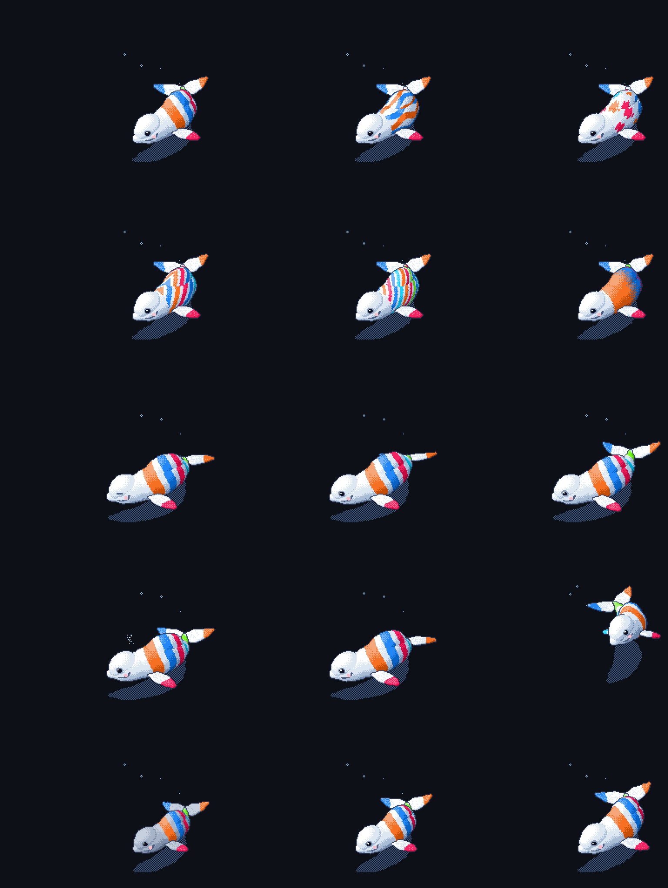

# git-beluga

Raise a pixel-art beluga from a GitHub account's activity and keep it on your profile
README as a looping GIF. Every night it redraws from what you did the day before.

Inspired by [git-koi](https://github.com/yalongwastaken/git-koi) by
[Anthony Yalong](https://github.com/yalongwastaken), which does the same with a fish. This is a separate implementation with its own art and rules.



## How your activity becomes a whale

| Your activity | The whale |
| --- | --- |
| Languages | Average across your repositories, with each repository counting equally. These color the body |
| Lifetime contributions | Size. Calves are grey for their first 25 contributions, then white, and keep growing up to 20,000 |
| Current weekly streak | A longer bubble trail, which thins out once a streak ends |
| Longest weekly streak | Richer colors, up to 26 weeks |

`legend.svg` lists each language's color and percentage, and updates with the whale. Forks and repositories with no code are skipped. A repository that is 83% Cuda and 17% C++
adds 0.83 and 0.17 to those languages, and the totals are divided by the number of
repositories, so a huge notebook repo counts the same as a small script.

In the default Rings pattern, each language gets one ring covering its share of the
colored skin, with white between the rings. The body tapers, so the same share makes a narrow ring on the wide back and a
longer one near the tail.

## Patterns

`rings` (default), `aurora`, `patches`, `tide`, `swirl` and `ombre`. Rings is the only one
whose coverage closely follows your percentages, within about 3 points over a lap; the
others spread colors roughly in proportion.

## Moods

The first rule that matches wins. "Today" means the last complete UTC day.

| Mood | When |
| --- | --- |
| Rest | 60+ quiet days. Barely moving, with its eyes shut |
| Drift | 14 to 59 quiet days, or no contributions ever. Slow laps |
| Cruise | 1 to 13 quiet days. An easy swim |
| Leap | Active, and the last 7 days crossed a milestone (100, 500, 1k, 5k, 10k, 25k, 50k) or beat 90% of the past year's active weeks (needs 10+ such weeks) |
| Greet | Active after 3+ quiet days. Two big spouts |
| Swim | Any other active day |

## On your profile

1. Copy [examples/profile-workflow.yml](examples/profile-workflow.yml) into your profile
   repository (the one named after your username) as `.github/workflows/beluga.yml`.
2. Add the whale and its color legend to its `README.md`:
   ```html
   
   <br><br>
   
   ```
3. Add a token so the nightly job can read your private repositories:
   - Create a [fine-grained token](https://github.com/settings/personal-access-tokens/new)
     with access to **All repositories**, and add the **Metadata: Read-only** repository
     permission.
   - Run `gh secret set BELUGA_TOKEN --repo <you>/<you>` and paste it in.

Only language percentages reach the GIF and the job's log. Private repository names are
never stored or printed, though anyone can see which languages you use from the whale.

GitHub pauses scheduled workflows after 60 days without repository activity, so if a
resting whale stops changing, re-enable the workflow from the Actions tab.

## From the command line

Needs Rust and an authenticated [GitHub CLI](https://cli.github.com).

```sh
cargo build --release
./target/release/git-beluga draw <login>                    # writes beluga/beluga.gif
./target/release/git-beluga draw <login> --pattern swirl
./target/release/git-beluga draw <login> --mood leap        # preview another mood
./target/release/git-beluga collect <login> -o me.json      # save the data, render it later
./target/release/git-beluga render me.json
./target/release/git-beluga sheet -o docs/sheet.png         # regenerate the image above
```

The result depends only on the snapshot, so the same data always draws the same pixels.

## License

MIT
